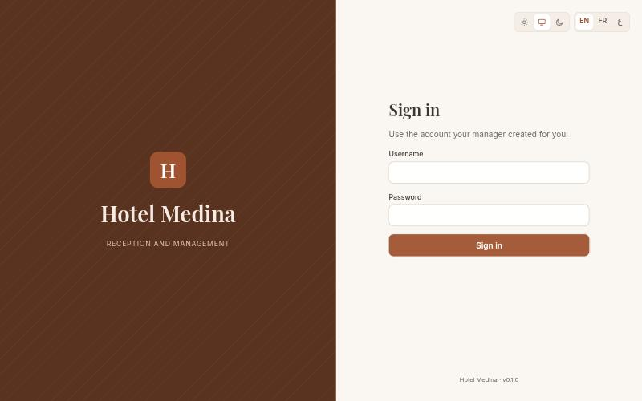
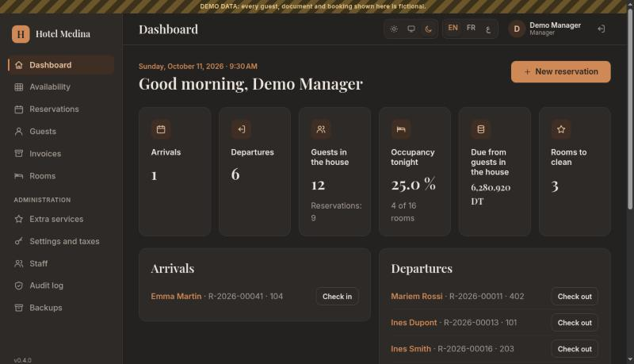
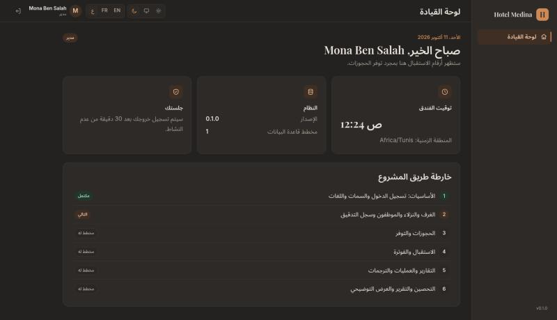
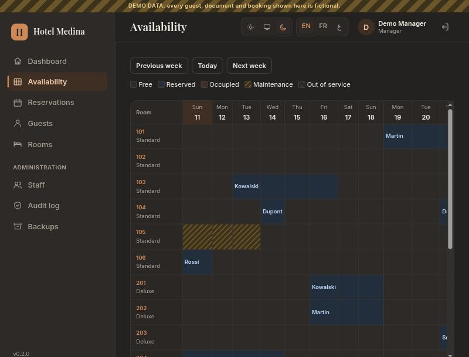
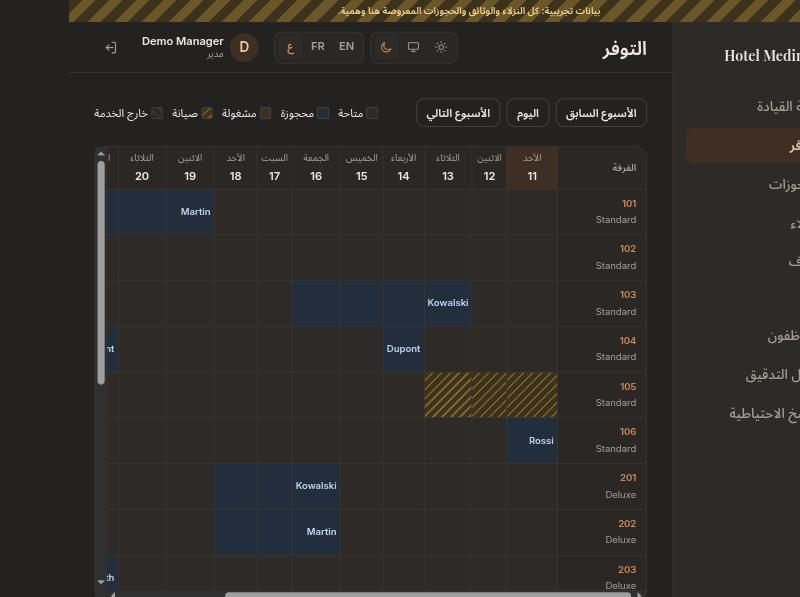
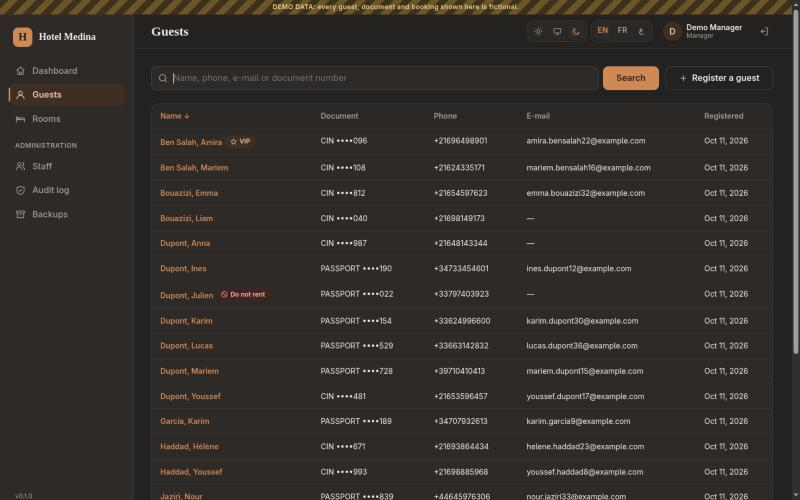
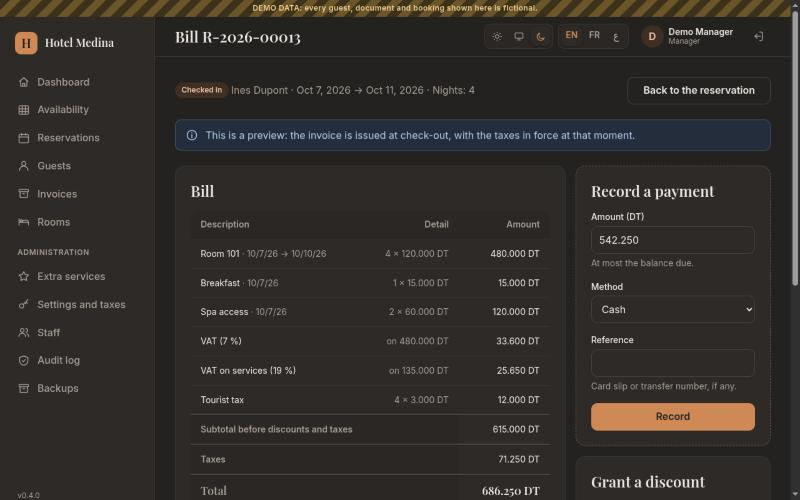
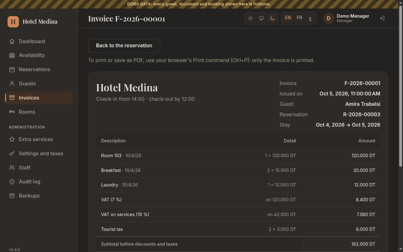

# Hotel Reservation and Management System

A secure, multilingual web application that helps a hotel's receptionists and
managers handle rooms, guests, reservations, check-in and check-out, extra
services, billing with taxes, and management reports, without double bookings.

Semester project for the *Python Programming* course (Engineering, Cybersecurity,
1st year). Built in two-week sprints; see the [roadmap](docs/roadmap.md).

[](https://github.com/MrWillingten/hotel-management-system/actions/workflows/ci.yml)


| Sign-in (light) | Front-desk dashboard (dark) | Arabic, right-to-left |
|---|---|---|
|  |  |  |

| Availability grid (demo data) | The same grid in Arabic | Guest search |
|---|---|---|
|  |  |  |

| Bill with taxes and a deposit | Issued invoice (print-ready) |
|---|---|
|  |  |

## Status

**v0.4.0 – Sprint 4** is complete. The application can already:

* **Run the front desk**: today's arrivals and departures, check-in, no-shows, check-out, rooms to clean, occupancy tonight and money still due
* **Bill exactly**: nights at their locked prices, extra services, manager discounts (capped), configurable taxes, deposits, payments and refunds, all in integer millimes
* **Issue invoices** at check-out with gap-free numbers (`F-2026-00001`); issued invoices can never be changed, and print cleanly
* **Take reservations** for one or more rooms, with exact prices locked per night, and explain refusals with free alternatives
* **Change and cancel reservations**, applying the hotel's late-cancellation fee (20 % by default, set by the manager) automatically
* **Show availability** as a rooms × 14 nights grid
* **Never double-book**, even when two receptionists click at the same moment (proved by a race test)
* **Manage rooms, guests and staff** with duplicate detection, masked ID numbers and role-based access
* **Keep a tamper-evident audit log** and **back up** the database every day
* **Speak English, French and Arabic** (right-to-left), in light or dark mode, on any screen size
* 480+ automated tests, run on Ubuntu and Windows by GitHub Actions

Reports, charts, CSV export and the night audit arrive in Sprint 5 ([roadmap](docs/roadmap.md)).

## Quick start

Requires **Python 3.11 or newer**. Works on Windows 10/11 and Linux.

**Linux**

```bash
python3 -m venv .venv
```

```bash
source .venv/bin/activate
```

**Windows (PowerShell)**

```powershell
py -m venv .venv
```

```powershell
.venv\Scripts\Activate.ps1
```

**Then, on both systems** (the lock file pins every dependency by hash)

```bash
pip install --require-hashes -r requirements-dev.lock
```

```bash
pip install --no-deps -e .
```

```bash
python -m hotel create-manager
```

```bash
python -m hotel run
```

Open <http://127.0.0.1:8000> and sign in with the account you just created.

| Command | What it does |
|---|---|
| `python -m hotel run` | Production server (Waitress) on 127.0.0.1:8000 |
| `python -m hotel run --dev` | Development server with auto-reload and debugger |
| `python -m hotel init-db` | Create or upgrade the database |
| `python -m hotel create-manager` | Create the first manager account |
| `python -m hotel reset-password USERNAME` | Give an account a temporary password (for example a forgotten manager password) |
| `python -m hotel night-audit [--date DAY]` | Close a finished day: no-shows, overdue departures, frozen figures (also automatic at start-up) |
| `python -m hotel seed --demo` | Fill an empty hotel with fictional demo data and demo accounts |
| `python -m hotel backup` | Write a backup now (also done automatically every day) |
| `python -m hotel restore FILE` | Replace the database with a backup (stop the application first) |
| `python -m hotel audit verify` | Check that no audit-log entry was altered or removed |
| `python -m hotel version` | Show the version |

Data (database, secret key, logs) is stored in `./instance`, or in the folder
named by `HOTEL_DATA_DIR`. See [docs/deployment.md](docs/deployment.md) for all
settings and for using the application from several computers over HTTPS.

## Tests and quality checks

```bash
pytest --cov
```

```bash
ruff check . && ruff format --check .
```

```bash
bandit -c pyproject.toml -r src
```

```bash
pip-audit --skip-editable
```

* `tests/unit` – domain rules, no database (includes property-based tests with Hypothesis)
* `tests/integration` – services against a real SQLite file (transactions, lockout, sessions)
* `tests/e2e` – full HTTP requests (access control on every route, CSRF, headers, XSS, translations)

## Architecture

```
web/ (Flask)  ─┐
cli.py        ─┴→ services/ → domain/ ← persistence/ (SQLite)
```

The domain is pure Python and never imports Flask or SQLite; a test enforces it.
Read more in [docs/architecture.md](docs/architecture.md).

| Document | Contents |
|---|---|
| [requirements.md](docs/requirements.md) | Actors, business rules, decisions on ambiguous points, scenarios |
| [architecture.md](docs/architecture.md) | Layers, modules, request lifecycle, error handling |
| [data-model.md](docs/data-model.md) | ERD and relational schema |
| [security.md](docs/security.md) | Threat review and the status of each control |
| [roadmap.md](docs/roadmap.md) | Sprints, Git workflow, Definition of Done |
| [adr/](docs/adr) | Architecture decision records |
| [translations.md](docs/translations.md) | How to update the French and Arabic texts |

## Development notes

This project is developed with the assistance of Claude Code (Anthropic).
Commits written with the assistant carry a `Co-Authored-By` trailer.

## Credits

* Fonts: [Inter](https://rsms.me/inter/), [Playfair Display](https://github.com/clauseggers/Playfair)
  and [Noto Sans Arabic](https://notofonts.github.io/), SIL Open Font License 1.1
  (licence texts in `src/hotel/web/static/fonts/`)
* Common-password list derived from [SecLists](https://github.com/danielmiessler/SecLists) (MIT)

## License

[MIT](LICENSE) © 2026 MrWillingten
