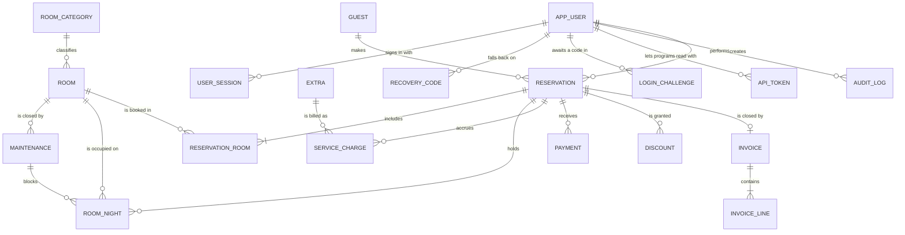

# Data model

The schema grows sprint by sprint through numbered migrations
(`src/hotel/persistence/migrations/NNNN_*.sql`). Tables marked ✅ exist today;
the others are the target design.

## Conceptual ERD



`TAX_RULE`, `SETTING`, `COUNTER` and `LOGIN_FAILURE` stand alone. Invoices copy
tax values instead of referencing `TAX_RULE`, so changing a rate never alters an
issued invoice.

## Relational schema

Notation: `PK` primary key · `FK` foreign key · `UQ` unique · `CK` check ·
`_mill` = millimes (INTEGER) · `_bp` = basis points (700 = 7.00 %).

```
✅ app_user(id PK, username UQ CK 3..32, full_name CK 1..100, password_hash,
            role CK∈{RECEPTIONIST,MANAGER}, is_active, must_change_password,
            failed_attempts CK≥0, locked_until, created_at, version,
            totp_secret, totp_pending_secret, totp_last_step, totp_enabled_at,
            totp_grace_until)                       → second factor (story 6.1)
✅ user_session(token_hash PK CK len=64, user_id FK→app_user ON DELETE CASCADE,
                created_at, last_seen_at, expires_at, ip, user_agent)
✅ login_failure(id PK, ip, username, at)          INDEX (ip, at)
✅ recovery_code(id PK, user_id FK ON DELETE CASCADE, code_hash CK len=64, used_at,
                 UQ(user_id, code_hash))
✅ login_challenge(token_hash PK CK len=64, user_id FK ON DELETE CASCADE, expires_at,
                   attempts CK≥0)                   → password accepted, code pending
✅ api_token(id PK, user_id FK ON DELETE CASCADE, name CK 1..60, token_hash UQ CK len=64,
             prefix, created_at, expires_at, last_used_at, revoked_at)   → JSON API (6.3)

✅ room_category(id PK, name UQ, description)
✅ room(id PK, number UQ, category_id FK, capacity CK>0, nightly_rate_mill CK≥0,
        in_service, notes, version, housekeeping CK∈{CLEAN,DIRTY},
        awaiting_inspection CK only when CLEAN)   → dirty / cleaned / inspected
✅ maintenance(id PK, room_id FK, start_date, end_date, reason, created_by FK,
               CK end_date > start_date)
✅ guest(id PK, first_name, last_name, id_doc_type CK∈{CIN,PASSPORT}, id_doc_number,
         nationality, phone, email, is_vip, do_not_rent, notes, is_active, created_at,
         version, anonymised_at, UQ(id_doc_type, id_doc_number))
✅ reservation(id PK, code UQ, guest_id FK, arrival, departure,
               status CK∈{CONFIRMED,CHECKED_IN,CHECKED_OUT,CANCELLED,NO_SHOW},
               cancellation_fee_mill, created_by FK, created_at, checked_in_at,
               checked_out_at, cancelled_at, version, CK departure > arrival)
✅ reservation_room(reservation_id FK, room_id FK, adults CK≥1, children CK≥0,
                    PK(reservation_id, room_id))
✅ room_night(room_id FK, night, reservation_id FK NULL, maintenance_id FK NULL,
              rate_mill, PK(room_id, night),
              CK exactly one of reservation_id / maintenance_id is set,
              CK a reserved night has a rate)
✅ extra(id PK, name UQ, unit_price_mill CK>0, is_active, version)
              ("extra service"; named so it is never confused with the service layer)
✅ service_charge(id PK, reservation_id FK, extra_id FK, description, quantity CK 1..99,
                  unit_price_mill, charge_date, created_by FK, created_at,
                  voided_at, voided_by FK, void_reason, CK void_reason iff voided)
✅ payment(id PK, reservation_id FK, amount_mill CK>0,
           kind CK∈{DEPOSIT,PAYMENT,REFUND}, method CK∈{CASH,CARD,TRANSFER},
           reference, paid_at, recorded_by FK)             append-only (triggers)
✅ discount(id PK, reservation_id FK, kind CK∈{PERCENT,FIXED}, rate_bp, amount_mill,
            reason NOT NULL, approved_by FK, created_at, removed_at, removed_by FK)
✅ tax_rule(id PK, name, kind CK∈{PERCENT,PER_ADULT_NIGHT}, rate_bp, amount_mill,
            applies_to CK∈{ACCOMMODATION,SERVICES}, is_active, version,
            CK exactly the value of its kind; per-night taxes on accommodation only)
✅ invoice(id PK, number UQ, reservation_id FK UQ, reservation_code, guest_name,
           arrival, departure, issued_at, issued_by FK, subtotal_mill, discount_mill,
           tax_mill, total_mill, paid_mill, balance_mill,
           CK total = subtotal - discount + tax, CK balance = total - paid)   immutable
✅ invoice_line(invoice_id FK, line_no, kind, label, quantity, unit_mill, amount_mill,
                first_date, last_date, rate_bp, PK(invoice_id, line_no))      immutable
✅ audit_log(id PK, at, user_id FK NULL, action, entity, entity_id, details, ip,
             prev_hash, hash)
✅ setting(key PK, value)              hotel.* keys = HotelSettings (story 4.8)
✅ counter(name, year, value, PK(name, year))                    gap-free invoice numbers
✅ form_token(token_hash PK, user_id FK, created_at) one-time submit tokens
✅ rate_period(id PK, category_id FK, name, start_date, end_date, rate_mill CK>0, created_at,
               CK end_date > start_date)       seasonal prices; no overlap per category (service)
✅ daily_snapshot(day PK, nights_sold, nights_sellable, room_value_mill, invoiced_mill,
                  cash_mill, reservations_made, cancellations, no_shows,
                  overdue_departures, created_at, created_by FK)   night audit (PK = run once)
```

## Conventions

* Timestamps: UTC ISO-8601 text **with microseconds**, so they sort correctly as text.
* Calendar dates: `YYYY-MM-DD`.
* Booleans: `INTEGER` 0/1 with a `CHECK`.
* `version` columns implement optimistic locking (`UPDATE … WHERE id = ? AND version = ?`).
* Prices copied at booking time (`rate_mill`, `unit_price_mill`) are deliberate
  denormalisation for historical accuracy.
* `PRAGMA foreign_keys = ON`, `busy_timeout = 5000`, `synchronous = FULL` on every
  connection; `journal_mode = WAL` once per database.
