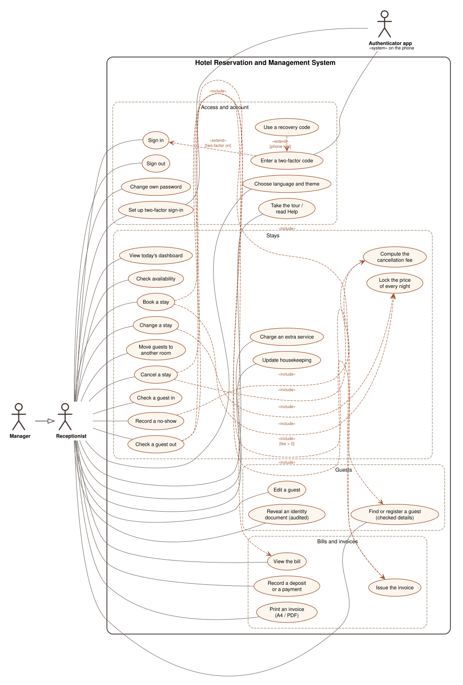
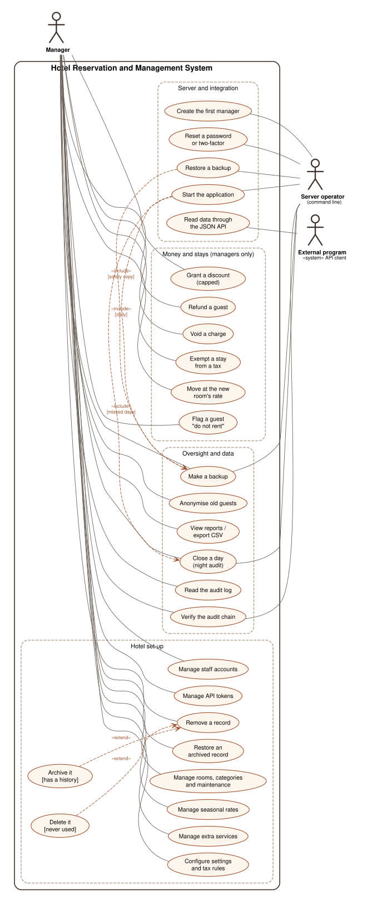
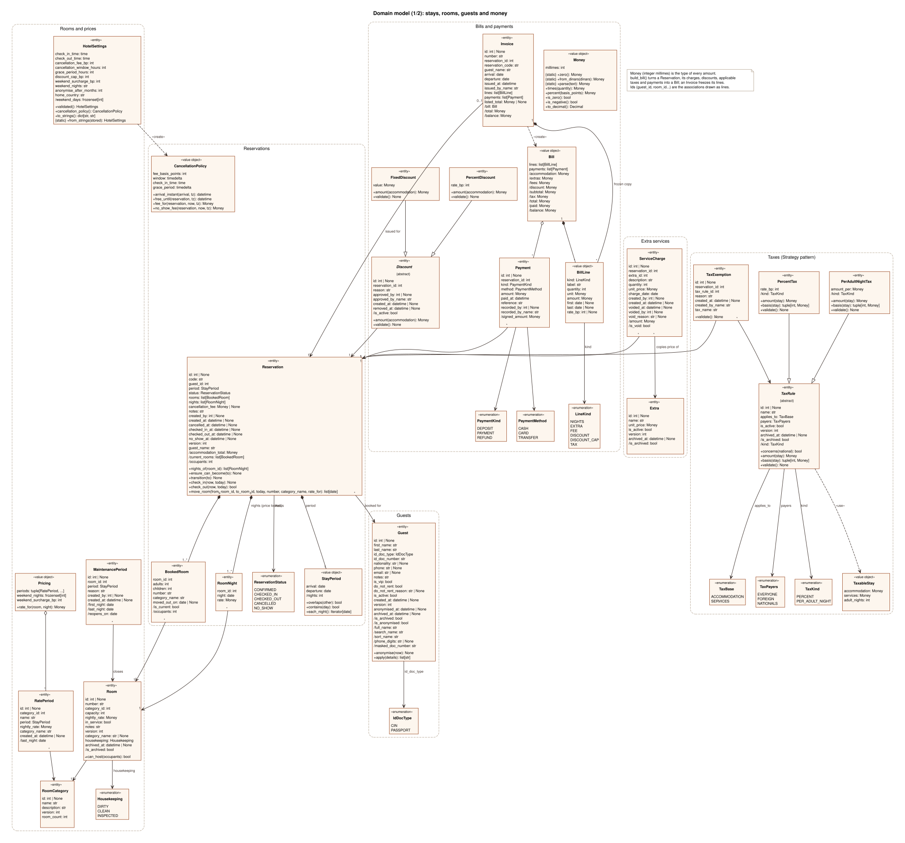
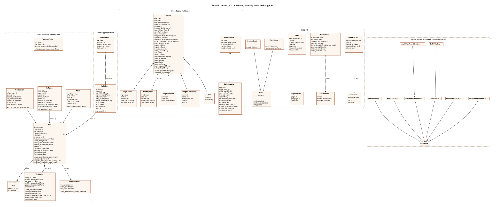
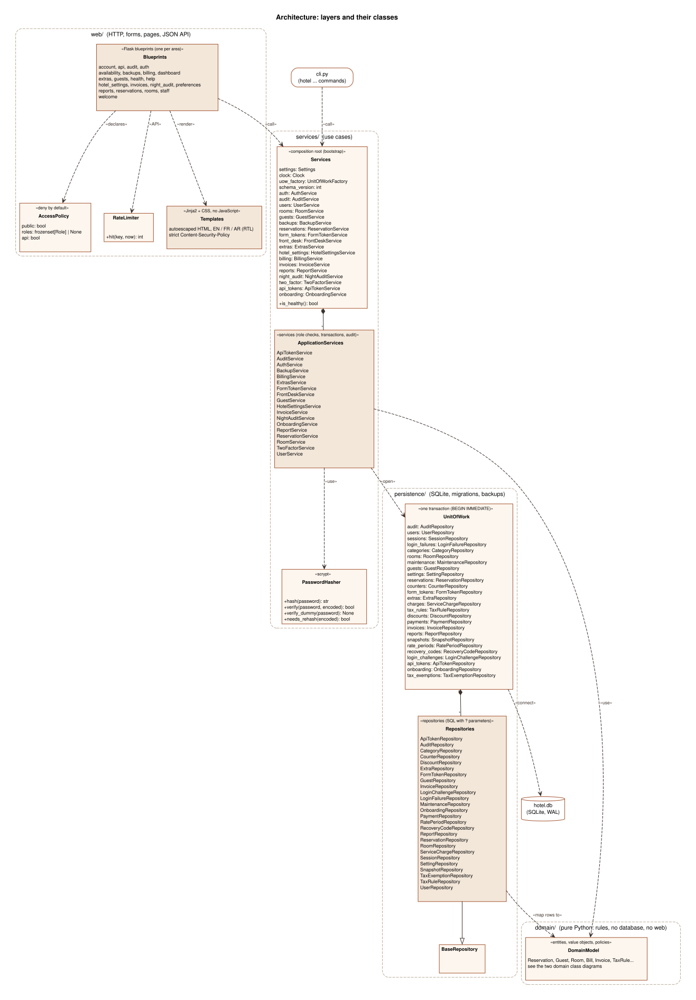

# UML diagrams

| Diagram | Source | Picture |
|---|---|---|
| Use cases 1/2: front desk (Receptionist; the Manager inherits all of it) | [use-cases-front-desk.dot](use-cases-front-desk.dot) | [SVG](use-cases-front-desk.svg) · [PDF](use-cases-front-desk.pdf) |
| Use cases 2/2: management, server and other programs | [use-cases-management.dot](use-cases-management.dot) | [SVG](use-cases-management.svg) · [PDF](use-cases-management.pdf) |
| Classes 1/2: stays, rooms, guests and money | [classes-domain-stays.dot](classes-domain-stays.dot) | [SVG](classes-domain-stays.svg) · [PDF](classes-domain-stays.pdf) |
| Classes 2/2: accounts, security, audit and support | [classes-domain-accounts.dot](classes-domain-accounts.dot) | [SVG](classes-domain-accounts.svg) · [PDF](classes-domain-accounts.pdf) |
| Architecture: layers and their classes | [classes-architecture.dot](classes-architecture.dot) | [SVG](classes-architecture.svg) · [PDF](classes-architecture.pdf) |







## How they are made

* **Use case diagrams** are written by hand in Graphviz DOT, from the pages of
  the application and the role checks of the services (see the authorization
  matrix in [../security.md](../security.md#authorization-matrix)). The
  Manager specialises the Receptionist (generalisation).
* **Class diagrams** are generated from the source code by
  [class_diagrams.py](class_diagrams.py): attributes, types, enumeration
  values and operations are read with Python's `ast` module, so they always
  match the code. Only relationships and multiplicities are written by hand
  in that script. `tests/unit/test_diagrams.py` fails if the committed
  diagrams no longer match the code.

Notation: «stereotype», `/name` derived attribute (a Python property),
*italics* abstract class, ◆ composition, ◇ aggregation, ▷ generalisation,
dashed arrow dependency, numbers at line ends multiplicities.

## Regenerate

```
make -C docs/diagrams          # needs Graphviz: dot
```

The PDFs are vector graphics for the LaTeX report (`\includegraphics`).
